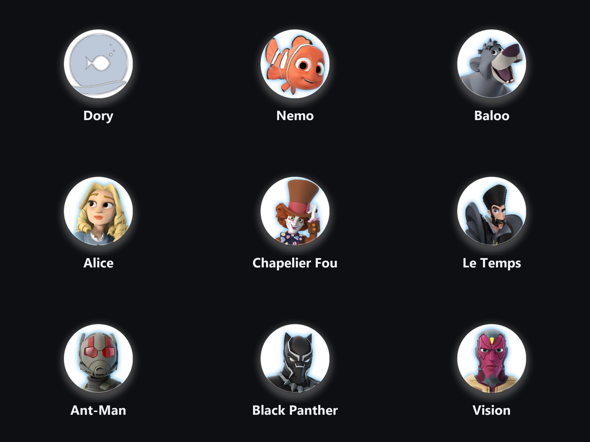

# Disney Infinity Complete — Version 1.0.0



A lightweight, 100% stable content unlock mod for **Disney Infinity 3.0: Gold Edition (PC, Steam)**, powered by **CrabeLoader**.

This mod surfaces all fully completed, official figures and costumes that already ship inside the PC Steam release archives but are hidden or locked on PC, paired with AaBysT's famous **"Any Character in Any Playset"** system.

> [!NOTE]
> **No game files are modified on disk.** All unlocks and patches are applied cleanly in memory at runtime.
> Every character in this release features **100% complete official models, textures, animations, voice lines, combat combos, super moves, and progression skill trees**.

---

## 🌟 Playable Figures (11 Heroes)

Every character is registered directly into the in-game character grid through the VirtualReader system and can be swapped instantly via the **F5** in-game menu.

### Marvel Battlegrounds (1.05)
- **Black Panther** (`AVG_BlackPanther`) — Vibranium claws, acrobatic combos, supermove, full skill tree (`in3_avg_blackpanther`).
- **Ant-Man** (`ANT_AntMan`) — Pym particle growth and shrinking combat mechanics, disc throw, full skill tree (`in3_ant_antman`).
- **Vision** (`AVG_Vision`) — Phasing, flight, solar beam, density manipulation, full skill tree (`in3_avg_vision`).
- **Captain America - Civil War** (`AVG_CaptainAmerica_CW`) — Hand-to-hand brawler moveset, tactical shield combos, full skill tree (`in3_avg_captainamerica_cw`).
- **Spider-Man - Black Suit** (`SPD_Spiderman_Black`) — Symbiote web-slinging, alien tendril attacks, dedicated skill tree upgrades.

### Alice Through the Looking Glass (1.06)
- **Alice** (`ALI_Alice`) — Flamingo croquet mallet, size-shifting mechanics, full skill tree (`in3_ali_alice`).
- **The Mad Hatter** (`ALI_MadHatter`) — Razor-edged hat throws, exploding tea cups, full skill tree (`in3_ali_madhatter`).
- **Time** (`ALI_Time`) — Chronosphere sceptre, temporal distortion attacks, full skill tree (`in3_ali_time`).

### Unlocked 3.0 Figures & Special Costumes
- **Baloo** (`TBX_Baloo`) — Jungle Book rhythmic combat, fruit barrage, full skill tree (`in3_tbx_baloo`).
- **King Mickey - Kingdom Hearts** (`TBX_Mickey_KingdomHearts`) — Official Black Coat / Organization XIII costume wielding the Keyblade.
- **Judy Hopps - Meter Maid** (`TBX_JudyHopps_MeterMaid`) — Official parking enforcement meter uniform variant.

---

## 🔓 Any Character in Any Playset (Anyone Can Cook II)

Ported from AaBysT's legendary native patch engine:
- **Play as anyone, anywhere:** Take Black Panther into the Star Wars galaxy, explore Marvel Battlegrounds with Alice, or bring King Mickey into the Twilight of the Republic playset.
- **Toggle anytime:** Press **F5 > Heroes > Any character in any playset** (saved persistently across sessions).

---

## ⚔️ Direct Warps (F5 Menu)

- **Marvel Battlegrounds (1.05):** Instant access to the Avengers HQ campaign hub, combat tutorial, versus hub, and the seven official battle arenas:
  - Asgard, Knowhere, Wakanda, Lunar Base, New York Sewers, Trainyard, and Ultron's Lair.
- **Hero Quick-Swap:** Switch to any of the 11 unlocked figures in real time without returning to the main menu.

---

## 📦 Installation (Steam / Nexus Mods)

1. Install [CrabeLoader](https://github.com/LucasLhomme/CrabeLoader) for *Disney Infinity 3.0: Gold Edition*.
2. Copy the `disney_infinity_complete` folder into your game's `mods/` directory:
   ```
   Disney Infinity 3.0 Gold Edition/
   └── mods/
       └── disney_infinity_complete/
           ├── mod.json
           ├── disney_infinity_complete.lua
           ├── playset_bypass.lua
           ├── dory_avatars_patch.lua
           └── characters/
   ```
3. Launch the game through Steam! Press **F5** in-game to access the mod menu.

---

## ℹ️ Scope & Finding Dory Note

- **Finding Dory (1.06):** Dory & Nemo require dedicated 3D aquatic swimming physics (`SwimMode`) and converted console assets. They are developed in a separate native expansion mod (`update_106`) to keep this mod lightweight, pure Lua, and 100% bug-free.
- **Unfinished Prototypes:** Cancelled figurines with missing textures or no animations (Maui, Peter Pan, Spider-Gwen) are intentionally excluded from this stable release.
